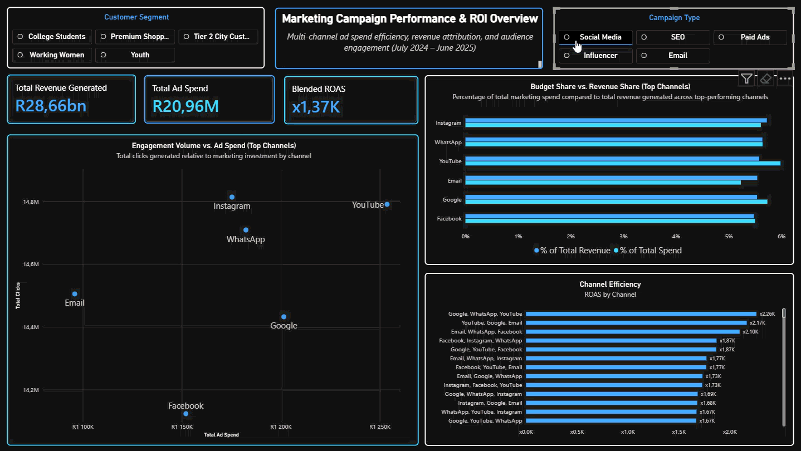

# Marketing Campaign Performance & ROI Analytics Dashboard

### 🖼️ Dashboard Preview


*Interactive slicing and cross-filtering in action:*



---

### 🎯 Business Objective
Built an end-to-end business intelligence pipeline to evaluate multi-channel digital marketing performance from **July 2024 to June 2025**. The dashboard enables marketing stakeholders to monitor total acquisition spend, compare budget allocation against revenue attribution, and identify high-efficiency customer segments and campaign types.

---

### 🛠️ Analytics Architecture & Tech Stack
* **Database & Storage:** PostgreSQL (Local Server via pgAdmin 4)
* **Data Transformation:** SQL (Daily multi-dimensional aggregation & schema design)
* **BI & Data Modeling:** Power BI Desktop (Import Mode, custom DAX measures, interactive cross-filtering)

**Data Pipeline:**
`Raw CSV Dataset` ➔ `PostgreSQL (raw_campaign_data)` ➔ `SQL Aggregation Layer` ➔ `Power BI Data Model` ➔ `DAX KPIs & Executive Dashboard`

---

### 📌 Key Data Context & Modeling Notes
To ensure analytical accuracy and avoid common BI reporting pitfalls, the following data modeling decisions were implemented:

1. **Synthetic Dataset Scale & High ROAS Ratios:**
   * The underlying dataset is a **fabricated (synthetic) dataset sourced from [Kaggle](https://www.kaggle.com/datasets/ishitabahamnia/nykaa-campaign-data-csv)**, not real company data. As a result, the revenue and cost figures are highly inflated and the ROAS is unrealistic: daily revenues frequently reach the millions against modest acquisition costs, resulting in a headline **Blended ROAS of 1,367.16x** (`R28.66bn` total revenue vs. `R20.96M` total spend).
   * Rather than altering the source figures, the model preserves raw data integrity while explicitly documenting the scale. The figures should be read as a demonstration of the analytics pipeline and dashboard design, not as real-world marketing performance benchmarks.
2. **Weighted Blended ROAS vs. Simple Averages:**
   * Pre-calculated row-level ratio columns (`roas`) were excluded from direct aggregation in Power BI to prevent distorted sums or unweighted averages.
   * Instead, **Blended ROAS** is calculated dynamically via DAX (`DIVIDE([Total Revenue Generated], [Total Ad Spend], 0)`), ensuring every campaign is properly weighted by its actual budget size across all slicer selections.
3. **True Grand-Total Share Percentages (`ALL()`):**
   * Visuals displaying **Top N** channels use explicit `CALCULATE(..., ALL(Query1[channel_used]))` DAX denominators so that `% of Total Spend` and `% of Total Revenue` reflect each channel's true share of the entire company budget rather than just the visible subset.
4. **Multi-Touch Channel Attribution & Slicer Granularity:**
   * The `channel_used` dimension tracks both single-channel and multi-touch combinations (e.g., `"YouTube, Google, WhatsApp"`). When combining multiple slicers (such as filtering to a single Customer Segment and Campaign Type simultaneously), smaller sample sizes can expose low-spend, high-return outlier combinations in the channel rankings while overall Blended ROAS remains stable.
5. **Two-Stage Aggregation Without Double-Counting:**
   * PostgreSQL groups raw records by `campaign_date`, `channel_used`, `customer_segment`, and `campaign_type` to compress row volume while retaining full slicing granularity for Power BI.

---

### 💻 Core SQL & DAX Logic

#### PostgreSQL Aggregation Query (`sql/01_kpi_metrics.sql`)

```sql
SELECT
    Channel_used,
    Campaign_type,
    Customer_segment,
    SUM(Acquisition_cost) AS Total_Spend,
    SUM(Clicks) AS Total_Clicks,
    SUM(Revenue) AS Total_Revenue,
    ROUND((SUM(Clicks) / NULLIF(SUM(Impressions), 0)::NUMERIC) * 100, 2) AS CTR_Percentage,
    ROUND(SUM(Revenue) / NULLIF(SUM(Acquisition_cost), 0), 2) AS ROAS,
    TO_DATE(Campaign_date, 'DD-MM-YYYY') AS Campaign_date,
    CASE 
       WHEN Channel_used LIKE '%,%' THEN 'Data Driven'
       ELSE 'Last Click'
    END AS Attribution_model
FROM
    raw_campaign_data
GROUP BY
    Channel_used, TO_DATE(Campaign_date, 'DD-MM-YYYY'), campaign_type, customer_segment
ORDER BY
    TO_DATE(Campaign_date, 'DD-MM-YYYY') DESC, Total_Revenue DESC
```

#### Key Power BI DAX Measures
```dax
Total Revenue Generated = SUM(Query1[total_revenue])

Total Ad Spend = SUM(Query1[total_spend])

Total Clicks = SUM(Query1[total_clicks])

Blended ROAS = DIVIDE([Total Revenue Generated], [Total Ad Spend], 0)

% of Total Spend = 
DIVIDE(
    [Total Ad Spend],
    CALCULATE([Total Ad Spend], ALL(Query1[channel_used])),
    0
)

% of Total Revenue = 
DIVIDE(
    [Total Revenue Generated],
    CALCULATE([Total Revenue Generated], ALL(Query1[channel_used])),
    0
)
```

---

### 💡 Key Dashboard Features
* **Executive KPI Strip:** Tracks Total Revenue Generated (`R28.66bn`), Total Ad Spend (`R20.96M`), and Weighted Blended ROAS (`x1.37K`).
* **Engagement Volume vs. Ad Spend (Scatter Plot):** Plots total clicks against acquisition cost across top channels to isolate cost-effective engagement outliers (such as high-click efficiency on WhatsApp vs. higher-cost channels).
* **Budget Share vs. Revenue Share:** Side-by-side percentage comparison highlighting discrepancies between ad spend allocation and actual revenue return across top channels.
* **Channel Efficiency Ranking:** Horizontal bar chart ranking channels by weighted Blended ROAS.
* **Dynamic Slicing:** Interactive tile slicers for **Customer Segment** and **Campaign Type**.
